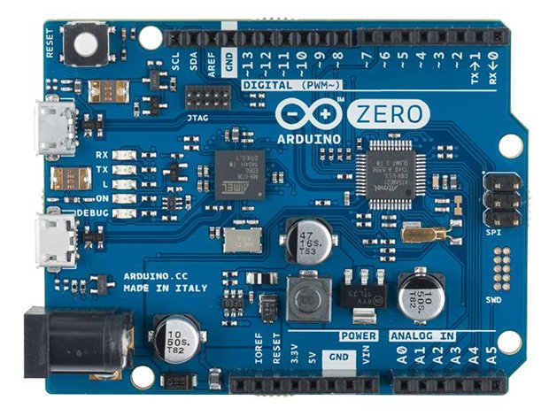
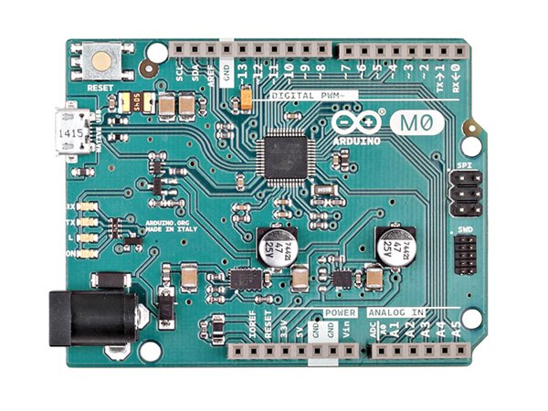
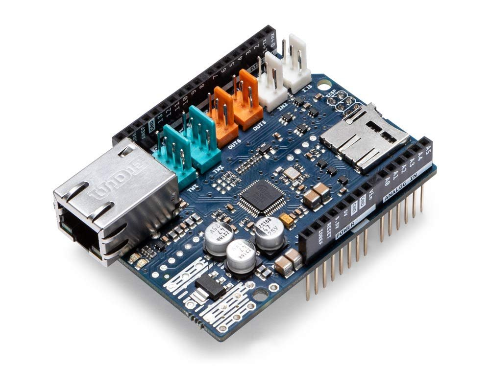
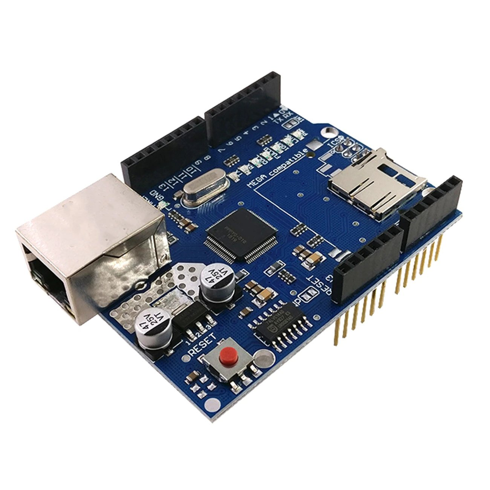
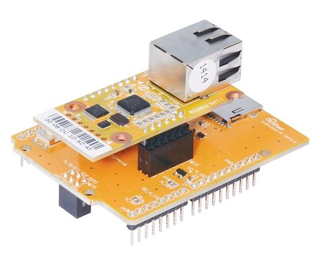
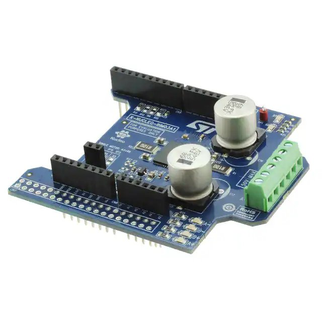
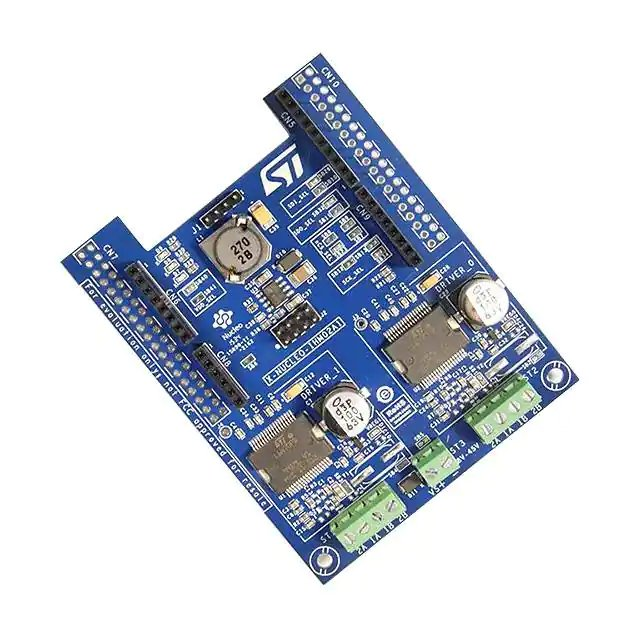
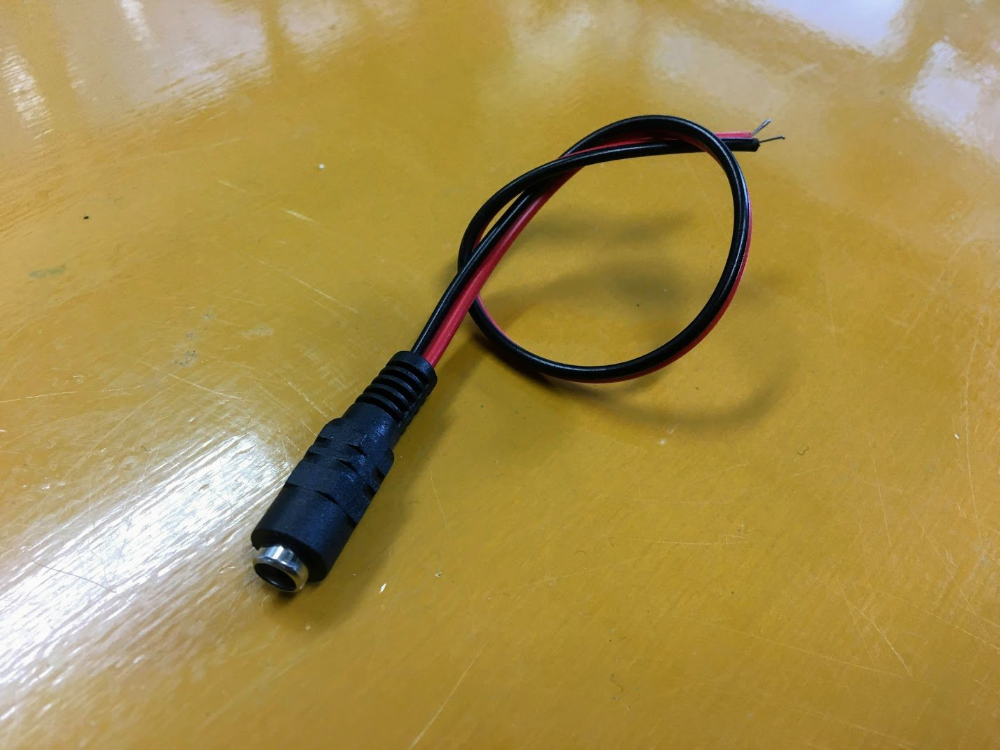

# Get the materials

The STEP100 and the STEP200 are made of an Arduino Zero (or a compatible board), an Ethernet shield and an X-NUCLEO board. This page lists what to get.

## Arduino Zero or M0 {#arduino}



The firmware is compatible with:

- Arduino Zero
- Arduino M0
- [Adafruit METRO M0 Express](https://www.adafruit.com/product/3505)

Compatible boards can be used too. The Arduino Zero is based on the Microchip `ATSAMD21G18` microcontroller (the board definition `zeroUSB` of PlatformIO, which the firmware uses, is for the `ATSAMD21G18A`), so look for a board of the Arduino Zero type that uses this microcontroller. Some compatible boards have the Arduino Zero bootloader and some have the Arduino M0 one; see [Arduino Zero or M0?](#zero-or-m0) for how to tell.

### Arduino Zero or M0? {#zero-or-m0}

These two models are almost identical, and either can be used. There are some differences, however, and you must take them into account when you build and upload the firmware (see [Upload the Arduino sketch](upload-the-sketch.md#m0)).

In terms of hardware, the D2 and D4 pins are swapped between the two models. Confusingly, some compatible products have the Arduino Zero bootloader written on Arduino M0 equivalent hardware. Even if the board is recognized as an Arduino Zero, it is safer to upload a sketch that blinks D2 and see whether D2 or D4 blinks.

If D2 and D4 are swapped on a board that is recognized as an Arduino Zero, define `MZERO_WITH_ZERO_BOOTLOADER` when you build the firmware. It is in `boardsDef.h`:

```
// #define MZERO_WITH_ZERO_BOOTLOADER
```

### Other Arduino models {#other-arduinos}

The SPI pins of the X-NUCLEO boards are not on the SPI connector, but on D11, D12 and D13. The Arduino Zero and M0 have the SPI function on these pins. The Arduino UNO also uses them as the SPI pins, so it could control the X-NUCLEO boards, but it cannot run the firmware of the STEP Series because its RAM and flash memory are small.

The Leonardo and the MEGA do not have the SPI function on D11-D13, so they cannot be used.

## Ethernet shield {#ethernet-shield}



The firmware has been tested with the [Arduino Ethernet Shield 2](https://docs.arduino.cc/hardware/ethernet-shield-rev2), which is based on the Wiznet W5500. Its official name is "Arduino Ethernet Shield 2" and the part number of the manufacturer is `A000024`. Major distributors of electronic components carry it.

There are also many compatible products of the older shield based on the W5100 at online shops. In our test they did not work for the STEP100 (X-NUCLEO-IHM03A1). They worked for the STEP200 (X-NUCLEO-IHM02A1).



A shield of this type cannot be used because you cannot put more shields on top of it. The Arduino and the Ethernet shield communicate through the 6-pin SPI connector, which the X-NUCLEO boards do not have. So you must always put the Ethernet shield on the Arduino, and then put the X-NUCLEO board on top of them.

## X-NUCLEO board {#x-nucleo}



These are evaluation boards of STMicroelectronics.

| Model | X-NUCLEO | Driver IC |
| --- | --- | --- |
| STEP100 | [X-NUCLEO-IHM03A1](https://www.st.com/en/ecosystems/x-nucleo-ihm03a1.html) | PowerSTEP01 |
| STEP200 | [X-NUCLEO-IHM02A1](https://www.st.com/en/ecosystems/x-nucleo-ihm02a1.html) | L6470 |

Besides the product pages of ST, major distributors of electronic components carry them.

## Power supply {#power-supply}

According to the datasheets of the X-NUCLEO boards, the voltage of the motor power supply is:

- IHM03A1 (PowerSTEP01): 10.5 V to 50 V
- IHM02A1 (L6470): 8 V to 45 V

To start experimenting, prepare a power supply of about 24 V and 4 to 5 A for both. For how to choose a power supply and a motor, see [Power supply and motor ratings](../connections/power-supply-and-motor.md#ratings).

The X-NUCLEO board has a screw terminal, so a cable with a DC jack is useful when you supply the power with an AC adapter.



The motor power supply does not power the Arduino, so the Arduino needs its own power. You can supply it from a PC or a USB charger through USB.
